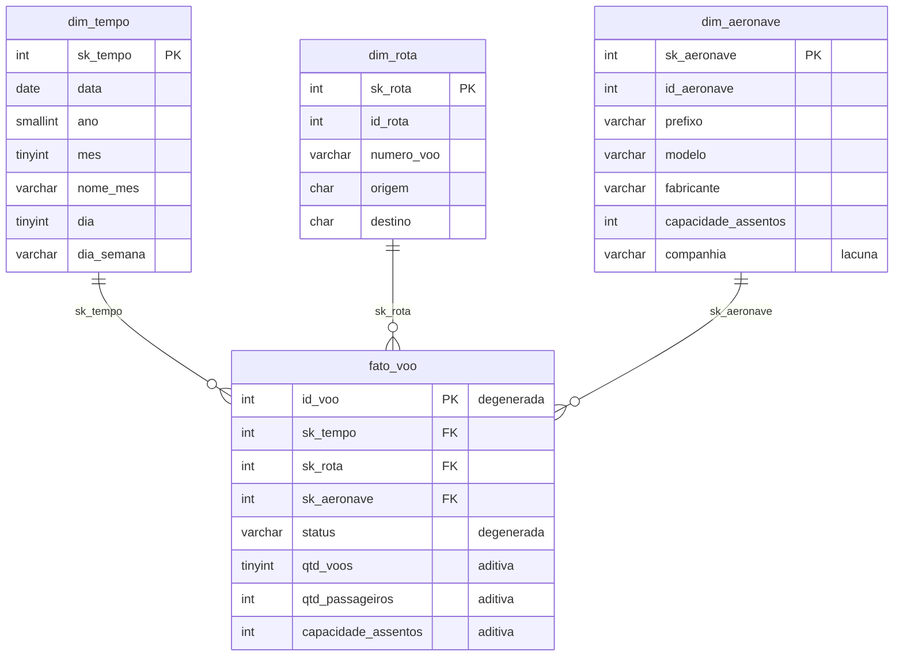

# Modelo estrela

Base: banco `aeroporto` (OLTP), esquema da Aula 10 com as alterações das aulas seguintes
que continuam no banco principal (`numero_voo` com prefixo `LA`, `voo.deleted_at` da
Aula 22). A Aula 30 renomeou `rota.origem` só no banco de teste `aeroporto_lab`; no
`aeroporto` a coluna continua `origem`, e é dela que o ETL lê.

## Grão

Uma linha da fato representa um voo: uma partida de uma rota, numa data, com uma
aeronave.

## Fato

`fato_voo`

| Coluna | Tipo de coluna | Classificação |
|---|---|---|
| `id_voo` | dimensão degenerada (chave do voo no OLTP) | |
| `status` | dimensão degenerada | |
| `sk_tempo`, `sk_rota`, `sk_aeronave` | chaves das dimensões | |
| `qtd_voos` | medida, sempre 1 | aditiva |
| `qtd_passageiros` | medida, passagens do voo | aditiva |
| `capacidade_assentos` | medida, assentos oferecidos no voo | aditiva |
| taxa de ocupação | medida derivada, `SUM(qtd_passageiros) / SUM(capacidade_assentos)` | não aditiva |

Nenhuma medida do modelo é semiaditiva. Semiaditiva seria uma medida de estado num
instante, como "aeronaves estacionadas no pátio no fim do dia": soma entre aeroportos,
mas não soma ao longo dos dias. O OLTP não registra estado no tempo, só eventos (voo,
passagem).

A ocupação é guardada pelas duas parcelas aditivas e calculada na consulta. A média das
ocupações de cada voo daria peso igual a um voo de 106 lugares e a um de 220, o que está
errado.

## Dimensões

| Dimensão | Atributos | Origem no OLTP |
|---|---|---|
| `dim_tempo` | `sk_tempo` (AAAAMMDD), `data`, `ano`, `mes`, `nome_mes`, `dia`, `dia_semana` | `DATE(voo.data_hora_partida)` |
| `dim_rota` | `sk_rota`, `id_rota`, `numero_voo`, `origem`, `destino` | `rota` |
| `dim_aeronave` | `sk_aeronave`, `id_aeronave`, `prefixo`, `modelo`, `fabricante`, `capacidade_assentos`, `companhia` | `aeronave` + `modelo_aeronave` |

`companhia` é a lacuna do painel 4: a coluna existe na dimensão e fica `NULL` enquanto o
OLTP não tiver o dado (ver [lacunas.md](lacunas.md)).

Não há `dim_passageiro`. Nenhum dos cinco painéis filtra ou agrupa por atributo do
passageiro, e o painel 2 conta passageiros transportados, que já é a medida
`qtd_passageiros`.

## Desenho

## Uma única fato atende aos cinco painéis?

Sim, desde que o grão seja o voo.

| Painel | Como sai de `fato_voo` |
|---|---|
| 1 Destinos | `COUNT(*)` por `dim_rota.destino` |
| 2 Passageiros por mês | `SUM(qtd_passageiros)` por `dim_tempo.mes` |
| 3 Número de voos | `COUNT(*)` |
| 4 Companhia | `COUNT(*)` por `dim_aeronave.companhia` |
| 5 Ocupação por modelo | `SUM(qtd_passageiros) / SUM(capacidade_assentos)` por `dim_aeronave.modelo` |

Se a única fato fosse a da passagem (uma linha por passagem), três painéis quebrariam.
Testado no OLTP, que tem a mesma forma de um join voo com passagem:

| Conta | Resultado |
|---|---|
| `COUNT(*)` de voo `JOIN` passagem | 12 linhas, contaria 12 "voos" |
| `COUNT(DISTINCT id_voo)` no mesmo join | 7 |
| `COUNT(*)` de `voo` | 8 |

O `COUNT(*)` conta o voo uma vez por passageiro. O `COUNT(DISTINCT)` corrige a
duplicidade mas ainda perde o voo 8, que não tem passagem vendida e não aparece numa fato
de passagens. E a capacidade da aeronave, repetida em cada passagem, somaria 180 três
vezes no voo 1, estragando a ocupação.

Uma segunda fato, `fato_passagem`, só seria necessária para perguntas no grão da
passagem: pessoas distintas por mês (`COUNT(DISTINCT sk_passageiro)`), classe, check-in.
Nenhum dos cinco painéis pede isso, então ela ficou de fora.
